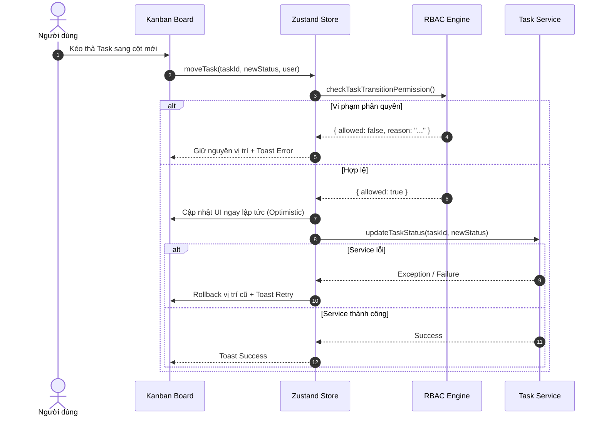

# ERP Web - Kiến Trúc Kỹ Thuật (Architecture & Technical Design)

Tài liệu thiết kế kiến trúc hệ thống giao diện phân hệ Quản lý công việc (Task Management) và Báo cáo ngày (Daily Report) thuộc hệ thống ERP nội bộ. Được chuẩn hóa theo tiêu chuẩn **Senior Frontend Engineer**, định hướng module hóa (Modular Architecture) để dễ dàng tích hợp thêm CRM, CMS và kết nối backend Laravel.

---

## 1. Tổng quan Kiến trúc Hệ thống (System Architecture)

Dự án áp dụng mô hình phân tầng **Layered & Feature-Sliced Architecture**, đảm bảo tính độc lập giữa Giao diện (Presentation), Quản lý trạng thái (State Management), Nghiệp vụ phân quyền (RBAC Engine) và Tầng giao tiếp dữ liệu (Service Layer).

```mermaid
graph TD
    UI["Giao diện Người dùng (React 19 / Next.js App Router)"]
    Store["State Layer (Zustand Store)"]
    RBAC["RBAC Engine (shared/permissions/can.ts)"]
    Service["Service Layer (Async Promise-based Contracts)"]
    Mock["Mock Data Store (localStorage / Faker SEED 2026)"]
    Laravel["Backend Laravel REST API (Giai đoạn sau)"]

    UI -->|Trigger action| Store
    Store -->|Validate transition rules| RBAC
    Store -->|Optimistic Update| UI
    Store -->|Fetch/Mutate data| Service
    Service -->|Hiện tại| Mock
    Service -.->|Sau này (Chỉ đổi Service)| Laravel
```

---

## 2. Thiết kế Module Hóa (Modular Structure)

Mã nguồn được phân tách theo nguyên lý tách rời quan tâm (Separation of Concerns):

```
src/
├── app/(dashboard)/          # Routing Layer (App Router)
│   ├── dashboard/            # Tổng quan Dashboard & KPI
│   ├── tasks/                # Bảng Kanban Jira & Danh sách Task
│   ├── daily-report/         # Báo cáo ngày & Theo dõi nộp
│   ├── approvals/            # Phê duyệt đề xuất công việc
│   ├── employees/            # Quản lý nhân sự & Thành viên
│   └── statistics/           # Phân tích hiệu suất & Recharts
│
├── modules/tasks/            # Domain-driven Task Module
│   ├── components/           # UI nội bộ của Module Task
│   ├── services/             # Lớp Service async cách ly hoàn toàn mock data
│   ├── store/                # Zustand Store quản lý state & optimistic updates
│   ├── schemas.ts            # Zod validation schema (Strict)
│   ├── constants.ts          # Hằng số cấu hình (Status, Priority, Approval toggle)
│   └── types.ts              # Data contracts & TypeScript Interfaces
│
├── shared/                   # Tài nguyên dùng chung cho toàn bộ ERP
│   ├── components/ui/        # Design system tokens chuẩn shadcn/ui
│   ├── permissions/          # can() function & Ma trận chuyển trạng thái
│   ├── store/                # useUserStore & useSidebarStore
│   └── mock/                 # Mock dữ liệu nhân sự và phòng ban
│
└── lib/                      # Pure utilities (cn, date-fns formatting)
```

---

## 3. Quản lý Trạng thái & Cơ chế Kéo thả (State Management & Optimistic DnD)

### 3.1. Luồng cập nhật lạc quan (Optimistic Update with Rollback)
Để đảm bảo trải nghiệm người dùng đạt tốc độ **60fps** không bị khựng (zero-latency feel):
1. **Bước 1**: Khi người dùng kéo thẻ Task sang cột mới, `@dnd-kit` bắn sự kiện `DragEndEvent`.
2. **Bước 2**: Gọi hàm `checkTaskTransitionPermission(currentUser, task, toStatus)`:
   - **Nếu vi phạm**: Giữ nguyên vị trí ban đầu của task, kích hoạt Toast cảnh báo giải thích rõ ràng lý do vi phạm.
3. **Bước 3**: Nếu hợp lệ, **cập nhật ngay lập tức** mảng `tasks` trong Zustand Store (UI đổi cột ngay lập tức).
4. **Bước 4**: Gọi `taskService.updateTaskStatus(taskId, toStatus)` chạy ngầm dưới nền.
5. **Bước 5**: Nếu API gặp sự cố (Network Error), tự động **Rollback** về trạng thái trước đó và báo lỗi cho người dùng.



---

## 4. Ma trận Phân quyền & Quản trị Vai trò Động (Dynamic RBAC + ABAC Scope)

Hệ thống triển khai mô hình phân quyền kép chuẩn **Enterprise ERP (tương thích Laravel Spatie & AWS IAM)**:
1. **Tầng 1 - Role-Based Access Control (RBAC)**: Quyền hạn kế thừa theo Vai trò hệ thống (`ADMIN`, `MANAGER`, `LEAD`, `EMPLOYEE`).
2. **Tầng 2 - User-Level Direct Overrides**: Cấp quyền đặc cách cho từng nhân sự cụ thể mà không cần nâng cấp vai trò của họ.
3. **Tầng 3 - Data Scope (ABAC)**: Ràng buộc phạm vi dữ liệu:
   - 🌐 `GLOBAL`: Xem/can thiệp toàn bộ dữ liệu công ty (Chủ tịch, Ban Giám Đốc).
   - 🏢 `DEPARTMENT`: Quản trị trong phạm vi phòng ban/dự án (Trưởng phòng, Tech Lead).
   - 👤 `OWN`: Chỉ truy cập dữ liệu do bản thân tạo ra hoặc được giao (Nhân viên).

### 4.1. Tính năng CRUD Vai trò Động (Custom Dynamic Roles)
- **Tạo vai trò tùy biến**: Admin có thể bấm `+ Thêm Vai Trò Mới` (VD: `CHAIRMAN` - Chủ tịch, `LEAD` - Trưởng nhóm, `AUDITOR` - Kiểm toán...).
- **Sinh cột động**: Bảng ma trận tự động render thêm cột tương ứng cho vai trò mới tạo, hỗ trợ tick chọn cấp quyền trực tiếp trong chế độ `isEditMode`.
- **Kế thừa quyền (Clone)**: Hỗ trợ sao chép nhanh toàn bộ quyền từ một vai trò có sẵn khi khởi tạo.
- **Sửa & Xóa an toàn**: Cho phép cập nhật tên, màu sắc, phạm vi dữ liệu. Tự động bảo vệ các vai trò hệ thống cốt lõi và chuyển nhân sự về vai trò mặc định nếu vai trò bị xóa.
- **Thu gọn / Mở rộng phân hệ**: Mỗi module hỗ trợ nút `ChevronDown` (thu gọn/mở rộng từng phân hệ) và nút điều khiển toàn cục `Thu gọn tất cả / Mở rộng tất cả`.

### 4.2. Bảng quyền hạn tham chiếu mặc định

| Thao tác nghiệp vụ | Ban Giám Đốc (ADMIN) | Trưởng phòng (MANAGER) | Trưởng nhóm (LEAD) | Nhân viên (EMPLOYEE) |
| :--- | :---: | :---: | :---: | :---: |
| **Phạm vi dữ liệu mặc định** | 🌐 Toàn công ty | 🏢 Phòng ban | 🏢 Phòng ban / Team | 👤 Cá nhân |
| **Xem toàn công ty** | ✅ Toàn bộ | ❌ Chỉ phòng mình | ❌ Chỉ phòng mình | ❌ Chỉ phòng mình |
| **Tạo & Giao việc cho cả phòng** | ✅ | ✅ | ✅ (Trong Sprint/Team) | ❌ Chỉ tạo cho bản thân |
| **Duyệt task "Pending Approval"** | ✅ | ✅ | ✅ | ❌ |
| **Kéo task sang "In Progress"** | ✅ | ✅ | ✅ | ✅ (Nếu được phân công) |
| **Kéo task sang "In Review"** | ✅ | ✅ | ✅ | ✅ (Gửi cấp trên review) |
| **Nghiệm thu đóng task "Done"** | ✅ | ✅ | ✅ | ❌ **Bắt buộc gửi Review** |
| **Đóng task hủy / Won't Fix** | ✅ | ✅ | ✅ | ❌ |
| **Mở lại task đã đóng (Reopen)** | ✅ | ✅ | ✅ | ❌ |
| **Khai báo Báo cáo ngày** | ✅ | ✅ | ✅ | ✅ (Chặn nộp trùng ngày) |
| **Xem báo cáo nộp của nhân viên** | ✅ Toàn cty | ✅ Phòng ban | ✅ Phòng ban | ❌ Chỉ xem của mình |
| **Thêm / Quản lý Nhân sự & Role** | ✅ Toàn quyền | ✅ Trong phòng | ❌ Chỉ xem danh sách | ❌ |

---

## 5. Chuẩn Quy Trình Đóng Task & Nghị Quyết (Jira Issue Resolution)

Hệ thống tuân thủ nghiêm ngặt nguyên lý **Enterprise Velocity & Sprint Metrics** của Jira:
- **Không bao giờ kéo task lỗi thời/không sửa vào cột "Done"**: Việc này làm sai lệch báo cáo năng suất sprint và số liệu KPI thực tế.
- **Cột "Closed / Cancelled" độc lập**: Đóng vai trò là cột trạng thái thứ 6 trên Kanban Board.
- **Bắt buộc gắn Resolution Code**:
  - `DONE`: Hoàn thành nghiệm thu chuẩn.
  - `NOT_A_BUG`: Không phải lỗi, đúng theo thiết kế hoặc do người dùng nhầm lẫn.
  - `WONT_FIX`: Lỗi hợp lệ nhưng không sửa (do tính năng sắp bỏ hoặc chi phí quá lớn).
  - `CANNOT_REPRODUCE`: Lỗi ngẫu nhiên không thể tái hiện trên môi trường test.
  - `DUPLICATE`: Trùng lặp với một issue/task khác đã có.
- **Lưu vết kiểm toán (Audit Trail)**: Ghi lại đầy đủ `closedAt`, `closedById` và `resolutionNote` (lý do đóng).
- **Quy trình Mở lại (Reopen Workflow)**: Cho phép mở lại task đóng khi có bằng chứng mới, tự động xóa cờ closed và đưa task về trạng thái `TO_DO`.

---

## 6. Quy chuẩn Chất lượng Mã nguồn (Quality Standard)

1. **TypeScript Strict**: Không sử dụng `any`, định nghĩa Type an toàn cho toàn bộ form, props và API contracts (`noImplicitAny: true`).
2. **Clean Components**: Tách nhỏ component, mỗi file đảm nhiệm một trách nhiệm duy nhất (Single Responsibility Principle).
3. **Accessibility (a11y)**: Hỗ trợ phím tắt điều hướng (`Ctrl+B` toggle sidebar), ARIA labels, bàn phím điều khiển dialog.
4. **Responsive & Modern CSS**: Hệ thống Design Tokens HSL trong [globals.css](file:///e:/Project_ItWebDev/JS/erp-fe/src/app/globals.css), tùy biến scrollbar mỏng, card shadow đẳng cấp doanh nghiệp.
5. **No Polling / Zero Hydration Mismatch**: Cung cấp `suppressHydrationWarning` trên các bộ đếm động phụ thuộc cache client-side để loại bỏ hoàn toàn lỗi hydration React 19.
