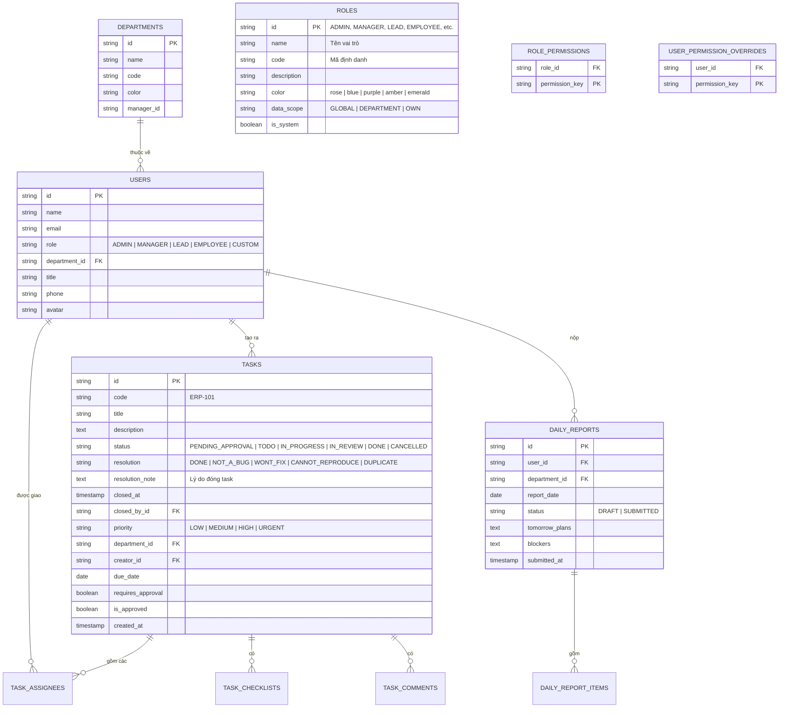

# Hướng Dẫn Tích Hợp Backend Laravel (Backend Integration Blueprint)

Tài liệu này cung cấp đặc tả kỹ thuật, cấu trúc cơ sở dữ liệu mẫu và các bước chi tiết để đội ngũ Backend **Laravel** dễ dàng ghép nối với giao diện Next.js hiện tại.

---

## 1. Thiết kế Cơ sở dữ liệu Laravel (Database Migrations)

Dưới đây là sơ đồ lược đồ quan hệ các bảng đề xuất cho cơ sở dữ liệu (PostgreSQL / MySQL):



> [!TIP]
> **Sơ đồ DBML trực quan trên dbdiagram.io**:
> Toàn bộ mã nguồn sơ đồ chuẩn DBML đã được đóng gói sẵn tại [`docs/DATABASE_SCHEMA.dbml`](file:///e:/Project_ItWebDev/JS/erp-fe/docs/DATABASE_SCHEMA.dbml). Copy toàn bộ nội dung file này và dán trực tiếp vào **[dbdiagram.io/d](https://dbdiagram.io/d)** để xem biểu đồ quan hệ thực thể tương tác (ERD), có đầy đủ Table Groups màu sắc theo từng phân hệ và xuất file DDL SQL (PostgreSQL / MySQL / Laravel Migration).

---

## 2. Đặc tả API RESTful (API Endpoints Specification)

Toàn bộ các URL dưới đây được thiết kế theo chuẩn RESTful JSON:

### 2.1. Phân hệ Quản lý Công việc (Task Endpoints)
| Phương thức | Đường dẫn API | Mô tả | Query Parameters / Body |
| :--- | :--- | :--- | :--- |
| `GET` | `/api/v1/tasks` | Lấy danh sách công việc | `search`, `departmentId`, `assigneeId`, `priority`, `status`, `resolution` |
| `POST` | `/api/v1/tasks` | Tạo mới công việc | `{ title, description, departmentId, priority, assigneeIds, dueDate, tags }` |
| `GET` | `/api/v1/tasks/{id}` | Chi tiết một công việc | - |
| `PATCH` | `/api/v1/tasks/{id}/status` | Đổi trạng thái (Kanban DnD) | `{ status: "IN_PROGRESS" }` |
| `POST` | `/api/v1/tasks/{id}/close` | Đóng task hủy / Won't Fix (Jira standard) | `{ resolution: "WONT_FIX", note: "..." }` |
| `POST` | `/api/v1/tasks/{id}/reopen` | Mở lại task đã đóng | - |
| `PUT` | `/api/v1/tasks/{id}` | Cập nhật thông tin task | `{ title, description, priority, ... }` |
| `DELETE` | `/api/v1/tasks/{id}` | Xóa công việc | - |
| `POST` | `/api/v1/tasks/{id}/approve` | Phê duyệt đề xuất task | - |
| `POST` | `/api/v1/tasks/{id}/reject` | Từ chối đề xuất task | `{ reason: string }` |
| `POST` | `/api/v1/tasks/{id}/comments` | Thêm bình luận | `{ content: string }` |
| `PATCH` | `/api/v1/tasks/{id}/checklist/{itemId}` | Đổi trạng thái checklist | `{ isCompleted: boolean }` |

### 2.2. Phân hệ Quản trị Vai trò & Phân quyền (RBAC Endpoints)
| Phương thức | Đường dẫn API | Mô tả | Body |
| :--- | :--- | :--- | :--- |
| `GET` | `/api/v1/roles` | Lấy danh sách các vai trò (kèm danh mục quyền) | - |
| `POST` | `/api/v1/roles` | Tạo vai trò mới (Custom Role) | `{ name, code, description, dataScope, color, cloneFromRoleId? }` |
| `PUT` | `/api/v1/roles/{id}` | Cập nhật thông tin vai trò | `{ name, description, dataScope, color }` |
| `DELETE` | `/api/v1/roles/{id}` | Xóa vai trò tùy biến | - |
| `PUT` | `/api/v1/roles/{id}/permissions` | Cập nhật ma trận quyền cho vai trò | `{ permissions: string[] }` |
| `PUT` | `/api/v1/users/{id}/permissions` | Gán quyền ngoại lệ cá nhân (User Overrides) | `{ permissions: string[] }` |

### 2.3. Phân hệ Báo cáo ngày (Daily Report Endpoints)
| Phương thức | Đường dẫn API | Mô tả | Body |
| :--- | :--- | :--- | :--- |
| `GET` | `/api/v1/reports` | Lấy báo cáo theo ngày/phòng ban | `date=YYYY-MM-DD`, `departmentId` |
| `GET` | `/api/v1/reports/user/{userId}` | Lấy báo cáo của 1 nhân sự theo ngày | `date=YYYY-MM-DD` |
| `POST` | `/api/v1/reports` | Nộp hoặc lưu nháp báo cáo | `{ date, status, todayWorks: [...], tomorrowPlans, blockers }` |

### 2.4. Phân hệ Quản lý Nhân sự (HRM Endpoints)
| Phương thức | Đường dẫn API | Mô tả | Body |
| :--- | :--- | :--- | :--- |
| `GET` | `/api/v1/users` | Danh sách nhân sự công ty | `departmentId`, `role`, `search` |
| `POST` | `/api/v1/users` | Tạo mới nhân sự | `{ name, email, phone, title, departmentId, role }` |
| `PATCH` | `/api/v1/users/{id}/role` | Đổi vai trò hệ thống của nhân viên | `{ role: "LEAD" }` |
| `DELETE` | `/api/v1/users/{id}` | Xóa nhân sự | - |

---

## 3. Hướng dẫn Thay Thế Mock Service (Chỉ 2 Bước)

Các component React và Zustand Store **hoàn toàn không gọi mock data trực tiếp**, mà đều thông qua tầng Service:
- `src/modules/tasks/services/taskService.ts`
- `src/modules/tasks/services/reportService.ts`

### Bước 1: Cài đặt HTTP Client & Cấu hình Axios
Tạo file `src/lib/api-client.ts`:

```typescript
import axios from "axios";

export const apiClient = axios.create({
  baseURL: process.env.NEXT_PUBLIC_API_URL || "http://localhost:8000/api/v1",
  headers: {
    "Content-Type": "application/json",
    Accept: "application/json",
  },
  withCredentials: true, // Hỗ trợ Laravel Sanctum Cookie Session
});

// Interceptor bắt lỗi hoặc inject Token
apiClient.interceptors.response.use(
  (response) => response,
  (error) => {
    if (error.response?.status === 401) {
      // Điều hướng về trang đăng nhập nếu hết hạn phiên
      window.location.href = "/login";
    }
    return Promise.reject(error);
  }
);
```

### Bước 2: Thay ruột hàm trong `taskService.ts`

```typescript
// src/modules/tasks/services/taskService.ts
import { apiClient } from "@/lib/api-client";
import { Task, TaskFilterParams, TaskStatus } from "../types";

export const taskService = {
  async getTasks(params?: TaskFilterParams): Promise<Task[]> {
    const { data } = await apiClient.get<Task[]>("/tasks", { params });
    return data;
  },

  async createTask(newTaskData: any): Promise<Task> {
    const { data } = await apiClient.post<Task>("/tasks", newTaskData);
    return data;
  },

  async updateTaskStatus(id: string, newStatus: TaskStatus): Promise<Task> {
    const { data } = await apiClient.patch<Task>(`/tasks/${id}/status`, { status: newStatus });
    return data;
  },

  async deleteTask(id: string): Promise<boolean> {
    await apiClient.delete(`/tasks/${id}`);
    return true;
  },
};
```

Toàn bộ giao diện Kanban kéo thả, bộ lọc, modal form, thống kê Recharts và cơ chế rollback khi lỗi mạng sẽ tự động vận hành trơn tru với backend Laravel mà **không cần chỉnh sửa bất kỳ component UI nào**!
